# Incident Management on Ubuntu EC2: Manual Native Deployment + GitHub Actions CD

I deployed a three-tier **React + Node.js/Express + PostgreSQL** application **natively** on an AWS EC2 Ubuntu server: no Docker, with **Nginx** as the reverse proxy and **systemd** managing the API. I then automated later application updates with **GitHub Actions** over SSH, so that a `git push` runs the same deployment script I first ran by hand.

| | |
|---|---|
| **Repository** | https://github.com/abuabddullah/bongodev-incident-native |
| **Successful GitHub Actions deploy run** | `PASTE_ACTIONS_RUN_URL_HERE` |
| **AWS Region** | `us-east-1` (N. Virginia) |
| **Instance** | `bongodev-incident-ubuntu`, `t3.small`, 20 GiB gp3, **Ubuntu Server 26.04.1 LTS** (see [Deviations](#deviations-from-the-assignment)) |
| **Status** | ✅ Manual deploy, manual redeploy, and CI/CD redeploy verified. EC2 terminated. |

> The original project README and lab instructions are kept in [`docs/project-readme.md`](docs/project-readme.md) and [`step-by-step.md`](step-by-step.md).

---

## Architecture

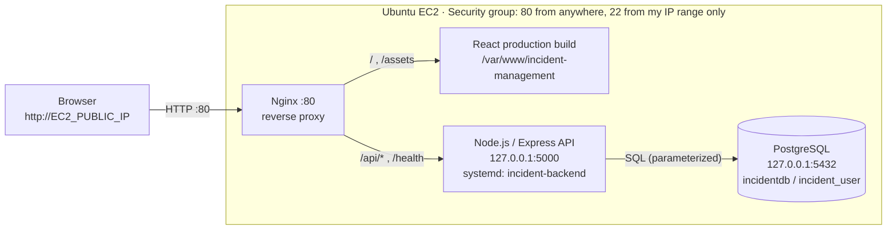

### How Browser → Nginx → Express → PostgreSQL work together

The browser talks only to **Nginx on port 80**, the single public entry point. For `/` and static assets, Nginx serves the pre-built React files directly from `/var/www/incident-management`, falling back to `index.html` for client-side routes. For `/api/*` and `/health`, Nginx acts as a **reverse proxy** and forwards the request to the **Express API**, which listens only on `127.0.0.1:5000`. Express validates the input and runs parameterized SQL against **PostgreSQL** on `127.0.0.1:5432`, where incidents are stored on disk. Because of this, data survives page refreshes, API restarts, and redeployments. **systemd** keeps the API alive: it restarts it on failure and starts it at boot. Ports 5000 and 5432 are never exposed to the internet; only Nginx is.

---

## What I Did

### 1. Launch and connect

- Launched `bongodev-incident-ubuntu` (`t3.small`, 20 GiB gp3) with key pair `asifiqrawave` and security group `bongodev-incident-sg`:
  - **SSH 22** from my own ISP address range only
  - **HTTP 80** from `0.0.0.0/0`
  - **5000 / 5432 / 5173 not opened**
- Connected from Windows PowerShell using OpenSSH. On Windows, the `.pem` file's permissions must be restricted first, or SSH rejects the key:
  ```powershell
  icacls.exe "$HOME\Downloads\asifiqrawave.pem" /inheritance:r
  icacls.exe "$HOME\Downloads\asifiqrawave.pem" /grant:r "$($env:USERNAME):(R)"
  ssh -i "$HOME\Downloads\asifiqrawave.pem" ubuntu@EC2_PUBLIC_IP
  ```
- Copied the project to the server with `scp` and extracted it to `/home/ubuntu/incident-management-ubuntu-ec2`.

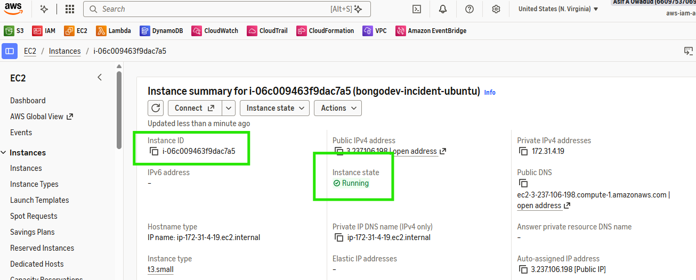

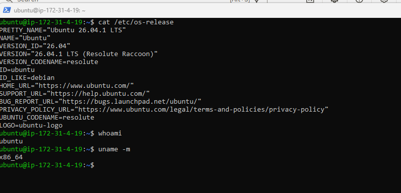

### 2. Install the stack natively (Choice A: one installer at a time)

```bash
bash scripts/install-nodejs-ubuntu.sh      # Node.js 24 from the signed NodeSource apt repo
bash scripts/install-postgresql-ubuntu.sh  # PostgreSQL from Ubuntu's repo, enabled with systemd
bash scripts/install-nginx-ubuntu.sh       # Nginx, enabled with systemd
sudo apt-get install -y git curl openssl rsync
```


### 3. Database and application user

`bash scripts/setup-database.sh` generated a random 48-hex-character password with `openssl rand`. It wrote the password to `backend/.env` with mode `600` (the file is git-ignored), created the **non-superuser** role `incident_user` and the database `incidentdb` owned by that role, and tested the login. The password never appeared on screen.

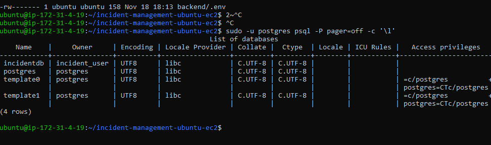

### 4. Manual deployment

`bash scripts/deploy-ubuntu.sh` ran these five steps:
1. `npm install` for the backend and frontend
2. `npm run build` (Vite production bundle)
3. Copied `dist/` to `/var/www/incident-management`, owned by `www-data`
4. Wrote and started the `incident-backend.service` systemd unit (`User=ubuntu`, `Restart=on-failure`, `NoNewPrivileges`, `ProtectSystem=full`, `PrivateTmp`)
5. Installed the Nginx site, removed the default site, and ran `nginx -t` before reloading Nginx

It finished with `{"status":"healthy","database":"connected"}`.

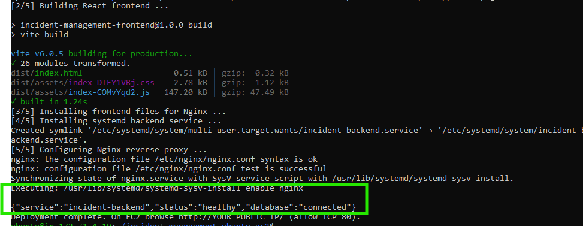

### 5. Verification

`verify.sh` reported **PASS**. `check-services.sh` showed `postgresql`, `nginx`, and `incident-backend` all **active**. The socket list confirms the security design: `:80` listens on all interfaces, while `:5000` and `:5432` listen only on `127.0.0.1`.

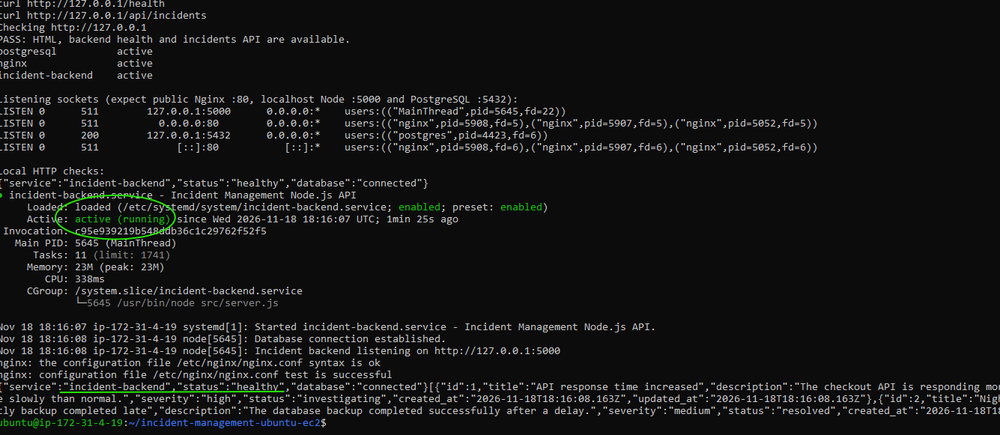


In the browser, I opened the app through the public IP, created an incident, changed its status, refreshed the page (the change persisted), and deleted an incident. I then confirmed the data directly in PostgreSQL:

```bash
sudo -u postgres psql -d incidentdb -c 'SELECT id, title, severity, status FROM incidents ORDER BY id DESC;'
```

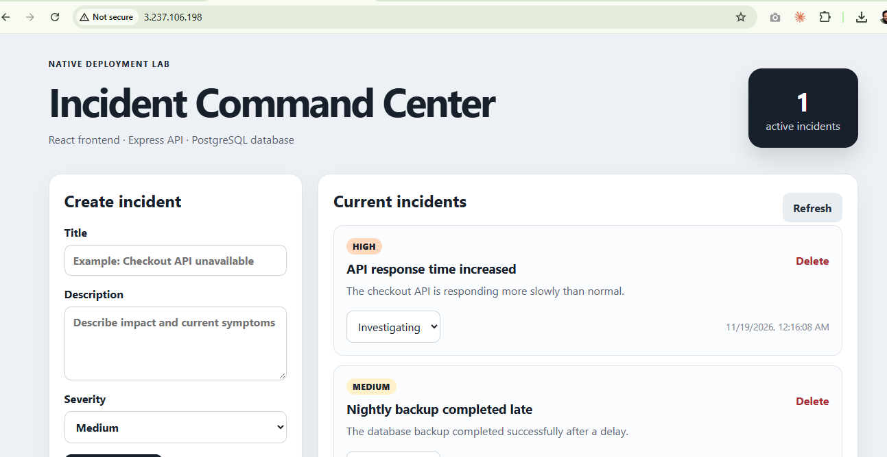
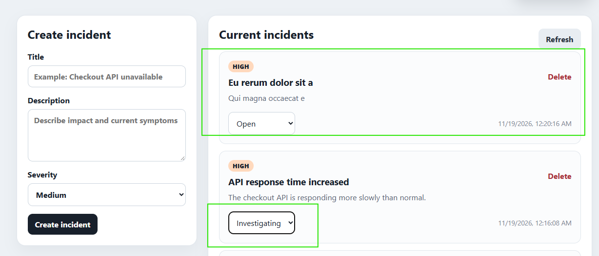
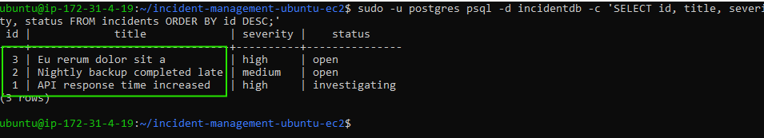

### 6. Manual redeployment

On the server, I changed the `<h1>` in `frontend/src/main.jsx` to **"Incident Command Center — Updated Manually"** and re-ran `bash scripts/deploy-ubuntu.sh`. The new heading appeared and **all existing incidents remained**, because the script never touches the database and the app only runs `CREATE TABLE IF NOT EXISTS`.

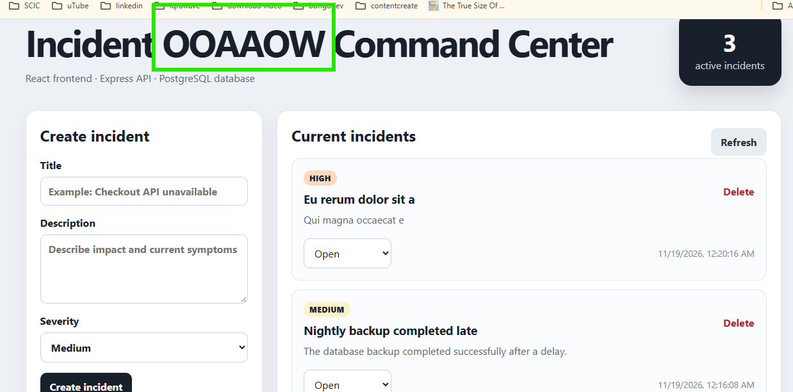

**systemd self-healing test:** I ran `sudo systemctl kill -s SIGKILL incident-backend`. About 3 seconds later, systemd had restarted the API under a **new PID** (`6289 → 6576`) and the service was `active (running)` again. This is `Restart=on-failure` with `RestartSec=3` at work. The journal also showed a graceful `SIGTERM received. Closing database connections.` during normal restarts.

### 7. Optional: CI/CD with GitHub Actions

The provided workflow builds first, then deploys the same code to the **existing** EC2 instance. It does not provision infrastructure.

```text
git push main → build job: npm install + backend syntax check + React build
             → deploy job: SSH (pinned host key) → rsync source (excluding .git, node_modules, dist, backend/.env)
             → ssh "bash scripts/deploy-ubuntu.sh" → systemd restart + Nginx reload
```

Setup:
- **Dedicated deploy key:** a passphrase-less `ed25519` key, created only for this disposable lab. Only its *public* half was appended to `~/.ssh/authorized_keys` on EC2, so the AWS `.pem` was never given to GitHub.
- **Pinned host key, no blind trust:** the server's ED25519 fingerprint taken *inside* EC2 (`sudo ssh-keygen -lf /etc/ssh/ssh_host_ed25519_key.pub`) matched the key in my verified `known_hosts`: `SHA256:AJrGVejKMokLeNkMeMd1k6Ml2x4SrJl09NygYgWEh+U`. That single line is the `EC2_SSH_KNOWN_HOSTS` secret, and the workflow uses `StrictHostKeyChecking=yes`.
- **Variables:** `EC2_HOST`, `EC2_USER=ubuntu`, `EC2_APP_DIR=/home/ubuntu/incident-management-ubuntu-ec2`. **Secrets:** `EC2_SSH_PRIVATE_KEY`, `EC2_SSH_KNOWN_HOSTS`. `DB_PASSWORD` is **not** in GitHub; `backend/.env` stays on the server and rsync excludes it.
- **Runner access to port 22:** `DESCRIBE_HOW_THE_RUNNER_REACHED_PORT_22`

I then changed the heading in the repository to **"Incident Command Center — GitHub Actions Deployment"** and pushed. The build and deploy jobs both succeeded, and the live site updated with the incidents preserved.

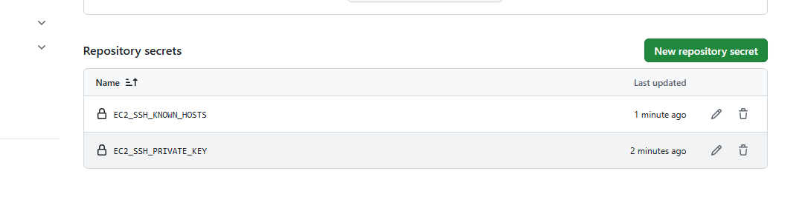
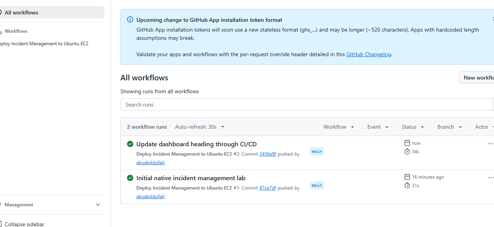
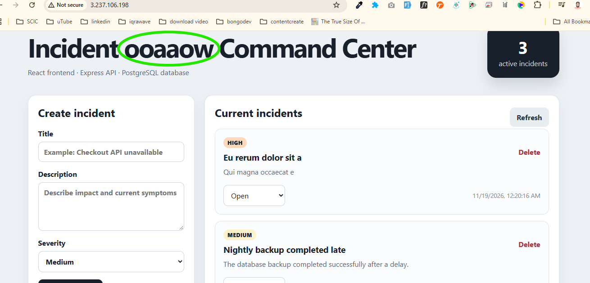

**How GitHub Actions connects to and updates the server:** On every push to `main`, a GitHub-hosted runner checks out the repository and proves that the code installs and builds. Only if that succeeds does the deploy job write the private deploy key and the pinned host key from repository secrets into the runner's `~/.ssh`, so it can SSH to the EC2 instance as `ubuntu`. It refuses to connect if the server's identity does not match. It then uses `rsync --delete` to make the server's source tree match the repository, excluding `backend/.env` so the database credentials stay on the server. Finally, over SSH it runs the same `scripts/deploy-ubuntu.sh` I used manually, which rebuilds the UI, restarts the systemd service, and reloads Nginx. The repository is now the source of truth: my earlier manual "Updated Manually" edit on the server was overwritten by the repository version.

### 8. Cleanup

- Deleted the GitHub secrets `EC2_SSH_PRIVATE_KEY` and `EC2_SSH_KNOWN_HOSTS`, and disabled the workflow.
- **Terminated** `bongodev-incident-ubuntu`. The root EBS volume was deleted on termination, and no Elastic IPs were allocated.
- Removed the deploy key pair from my computer and closed any temporary SSH access.

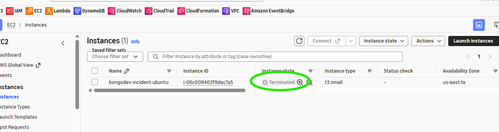

---

## Deviations from the Assignment

| Topic | Assignment | What I did and why |
|---|---|---|
| **Ubuntu version** | Ubuntu 24.04 LTS | The EC2 Quick Start default is now **Ubuntu 26.04.1 LTS (Resolute Raccoon)**. Every script fails fast unless `VERSION_ID == '24.04'`. I kept the scripts unchanged except for that one condition, which now also accepts `26.04`, in all 6 scripts: `[[ "$ID" == ubuntu && ( "$VERSION_ID" == '24.04' \|\| "$VERSION_ID" == '26.04' ) ]]`. Node.js still came from NodeSource 24.x, and PostgreSQL came from the 26.04 repository. Everything else worked unchanged. The repository contains the patched scripts so CI/CD deploys to the same server. |
| **Project ZIP** | Single project folder | The provided ZIP contained a duplicated nested copy of the project and the instructor's `.git` history. I removed both before use. No code was changed. |
| **SSH source rule** | "My IP" (`/32`) | My ISP rotates outbound IPv4 addresses. `checkip` showed `.98` and `.99`, and AWS saw yet another address, so `/32` and `/31` rules timed out. I diagnosed it by checking routing and the NACL, testing `Test-NetConnection github.com -Port 22` (True, so my ISP does not block 22), then briefly opening 22 to read `echo $SSH_CLIENT` on the server, and immediately restricting the rule again to my ISP's small range. |
| **Host-key scan on Windows** | `ssh-keyscan` | The Windows OpenSSH `ssh-keyscan` failed with `choose_kex: unsupported KEX method sntrup761x25519-sha512@openssh.com`: the server's OpenSSH 10.2 prefers post-quantum key exchange. I instead took the ED25519 line from my `known_hosts` (`ssh-keygen -F <ip>`) and verified its fingerprint against the one printed inside the server. |

---

## Answers to Extra-Credit Questions

**1. Why is PostgreSQL not exposed on public port 5432?**
The database holds the most valuable data. Exposed on the internet, it would face constant automated password guessing and could be hit directly by any PostgreSQL vulnerability. The application and the database run on the same machine, so the database only needs to accept local connections. It listens on `127.0.0.1`, and the security group does not open 5432, which gives two independent layers. The API is the only path to the data, and it enforces validation and parameterized queries. Remote administration, if ever needed, should go through SSH tunnelling or a private network, not a public port.

**2. What is the difference between an Ubuntu service (systemd) and an Nginx reverse proxy?**
**systemd** is the operating system's *process manager*. It starts the Node.js API, runs it as a non-root user with an environment file, restarts it if it crashes (`Restart=on-failure`), starts it on boot (`enabled`), and collects its logs (`journalctl`). **Nginx** is a *network-facing web server and reverse proxy*. It accepts the public HTTP traffic on port 80, serves static files efficiently, and forwards `/api` requests to the internal API. systemd keeps the backend *alive*; Nginx makes it *reachable safely*. Nginx is itself also a systemd service.

**3. Why do we build React using `npm run build` before deploying it?**
Browsers cannot run JSX or resolve npm imports directly. `vite build` compiles JSX to plain JavaScript, bundles and tree-shakes the dependencies, minifies the code, and fingerprints the asset file names for caching. The result is a small set of static files in `dist/`, which Nginx can serve quickly with no Node.js process involved. Running the Vite dev server (port 5173) in production would be slower, less secure, and not designed for real traffic.

**4. Why does changing React code require a build/redeploy, but creating an incident does not?**
React code is *application code*. Nginx serves the compiled files in `/var/www/incident-management`, so editing `main.jsx` changes nothing until the bundle is rebuilt and copied again. An incident is *data*. The already-deployed UI sends `POST /api/incidents`, and Express inserts a row into PostgreSQL at runtime. No files change and nothing needs to be rebuilt. Redeploying also preserves the data, because the deployment script never drops or recreates the database.

**5. Which actions could GitHub Actions perform automatically after `git push`?**
In this lab it ran these on every push to `main`: install dependencies, run the backend syntax check, build the React production bundle, SSH to the server with a pinned host key, `rsync` the source while excluding secrets and build artifacts, and run `deploy-ubuntu.sh`, which rebuilds the UI, updates the systemd unit, restarts the API, validates and reloads Nginx, and checks `/health`. It could also run unit and integration tests, lint, scan dependencies for vulnerabilities, create a release artifact once and deploy that exact artifact, run database migrations, post a smoke test after deploying, roll back automatically when health checks fail, and notify the team. With path filters, it could skip deployment for documentation-only commits.

---

## Security Notes

- No `.pem` contents, private deploy key, `backend/.env`, or database password appear in this repository or in the screenshots. The account ID and my home IP are redacted.
- Public ports: **80 only**. SSH (22) was limited to my ISP range. The API and the database are bound to `127.0.0.1`.
- Database access uses a dedicated non-superuser role with a random password stored in a `600`-mode file.
- The API runs as `ubuntu` (not root) under systemd hardening options.
- This is a classroom demo: HTTP only and no authentication. A production setup would add TLS (for example, Let's Encrypt), authentication, a dedicated least-privilege deploy user instead of the passwordless-sudo `ubuntu` user, and SSM- or OIDC-based deployment instead of inbound SSH from runners.

## Repository Structure

```
.
├── README.md                        # this submission report
├── step-by-step.md                  # original lab instructions
├── STUDENT_HOMEWORK.md              # original checklist
├── .github/workflows/deploy.yml     # build + SSH deploy workflow
├── backend/                         # Express + pg API (.env is git-ignored)
├── frontend/                        # React + Vite UI
├── deploy/nginx-incident-management.conf
├── scripts/                         # install, setup-database, deploy, verify, check-services
└── docs/
    ├── GITHUB_ACTIONS.md
    ├── project-readme.md            # original project README
    └── screenshots/                 # 01–16
```
